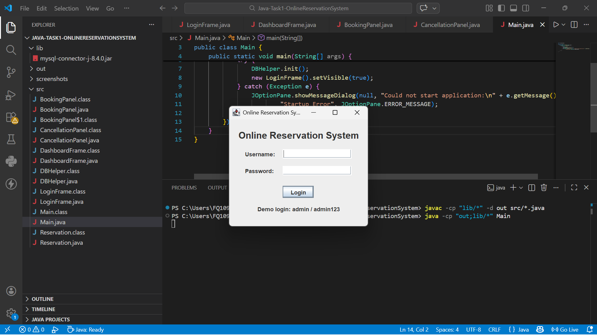
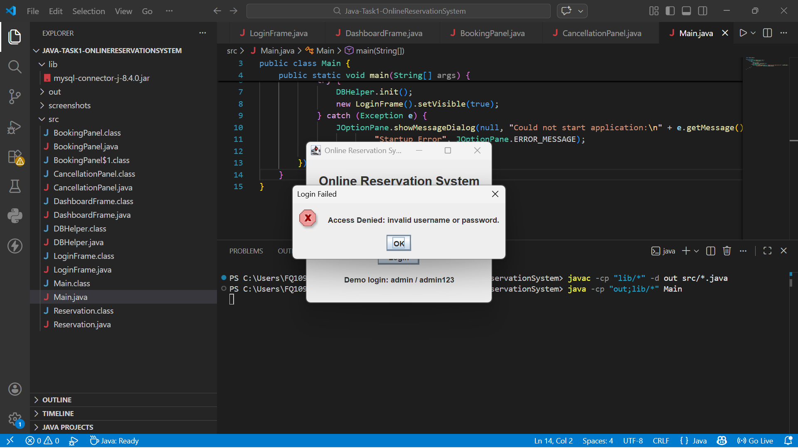
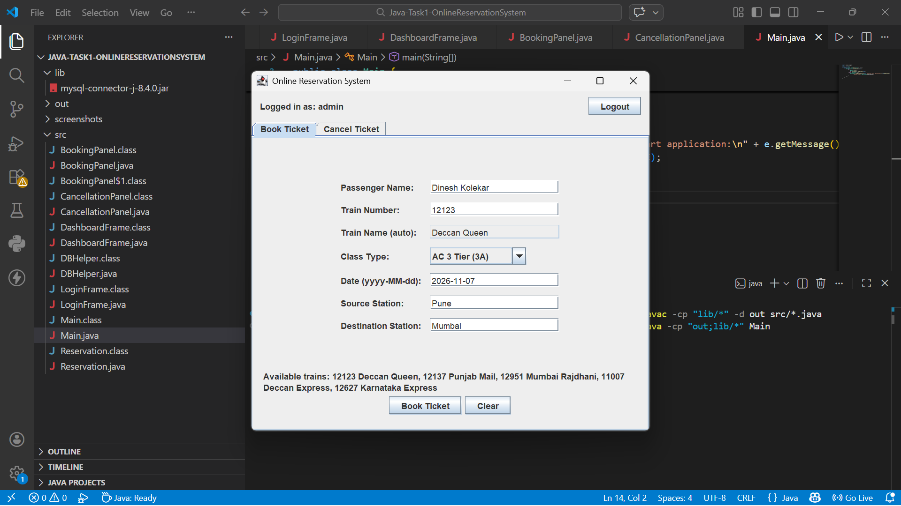
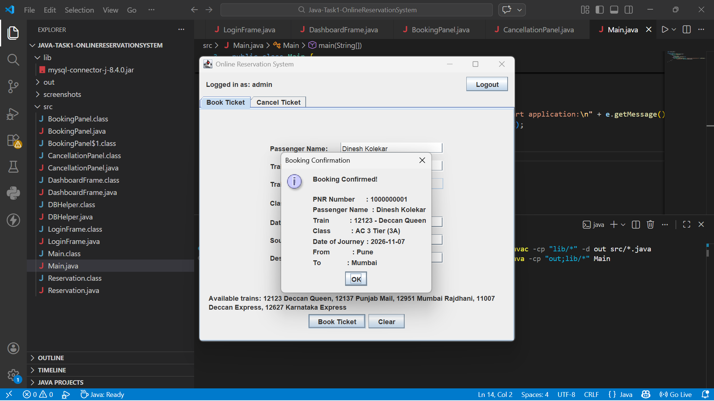
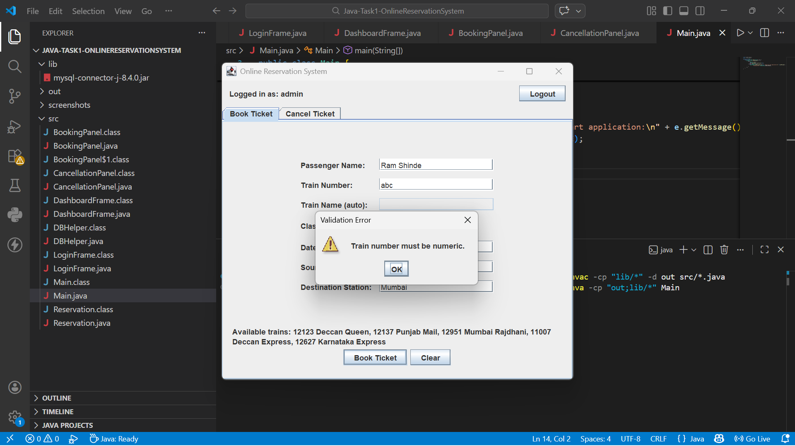
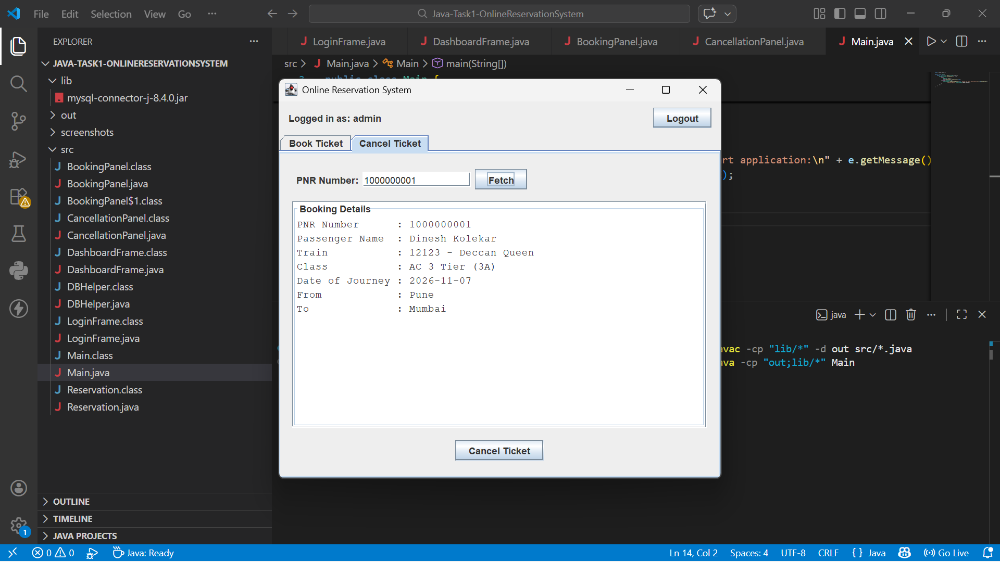
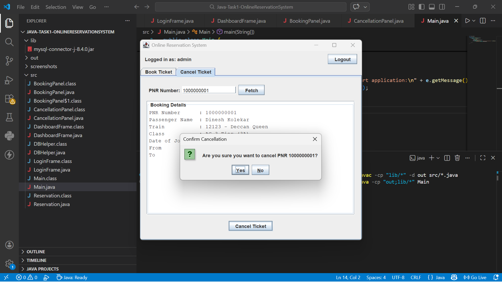
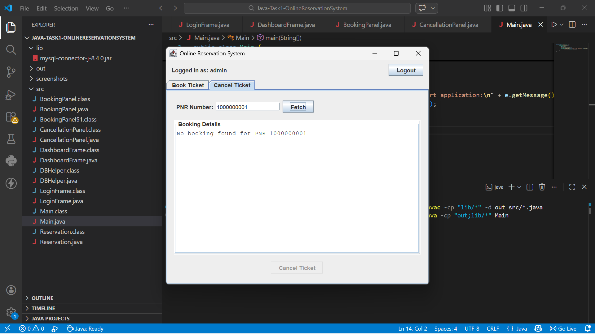
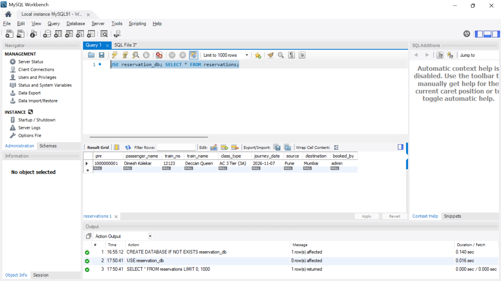

# Online Reservation System (Java)

GUI-based train reservation system built for the Oasis Infobyte Internship Program (Java Development, Task 1).

## Features
- Login form (access denied for invalid credentials, passwords stored as SHA-256 hash)
- Reservation form: passenger name, train number, train name (auto-populated), class type, date of journey, source, destination
- Booking saved to MySQL with an auto-generated unique PNR
- Confirmation dialog with booking details
- Cancellation form: enter PNR, fetch details, "Are you sure?" confirmation, booking removed from database
- Input validation (empty fields, numeric train number, date format, past dates, same source/destination)
- `PreparedStatement` used everywhere to prevent SQL injection

## Tech Stack
Java, Swing, JDBC, MySQL

## Project Structure
| File | Responsibility |
|------|----------------|
| `Main` | Entry point |
| `LoginFrame` | Login screen |
| `DashboardFrame` | Main window with tabs and logout |
| `BookingPanel` | Reservation form |
| `CancellationPanel` | Cancellation form |
| `DBHelper` | All JDBC / database operations |
| `Reservation` | Booking data model |

## Demo Logins
| Username | Password |
|----------|----------|
| admin | admin123 |
| dinesh | dinesh@123 |

## Available Trains
12123 Deccan Queen, 12137 Punjab Mail, 12951 Mumbai Rajdhani, 11007 Deccan Express, 12627 Karnataka Express

## Screenshots
| Login | Access Denied |
|---|---|
|  |  |

| Booking Form | Confirmation |
|---|---|
|  |  |

| Validation | Fetch Booking |
|---|---|
|  |  |

| Cancel Confirm | Cancelled |
|---|---|
|  |  |

| MySQL Data |
|---|
|  |

## How to Run
1. Install MySQL and create the database:
   ```sql
   CREATE DATABASE reservation_db;
   ```
2. Download the MySQL JDBC driver into the `lib` folder:
   https://repo1.maven.org/maven2/com/mysql/mysql-connector-j/8.4.0/mysql-connector-j-8.4.0.jar
3. In `DBHelper.java` set your MySQL username and password (`DB_USER`, `DB_PASS`).
4. Compile and run (from project root):
```bash
javac -cp "lib/*" -d out src/*.java
java -cp "out;lib/*" Main
```

Tables and demo data are created automatically on first run.

## Author
Dinesh Balaso Kolekar - Java Development Intern, Oasis Infobyte