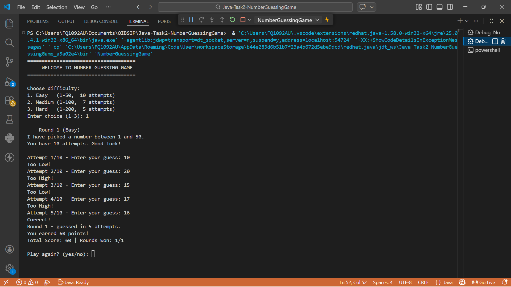
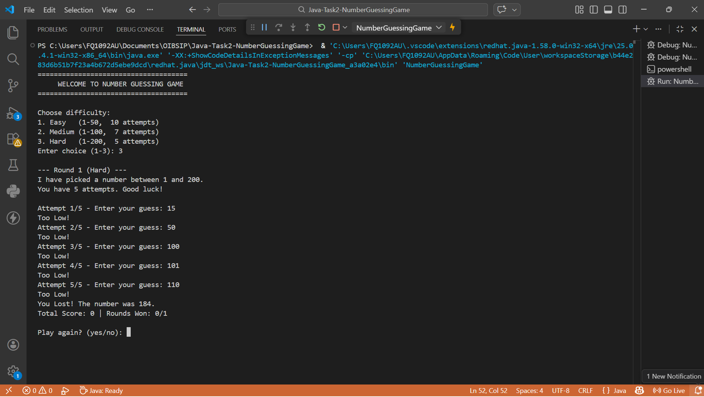
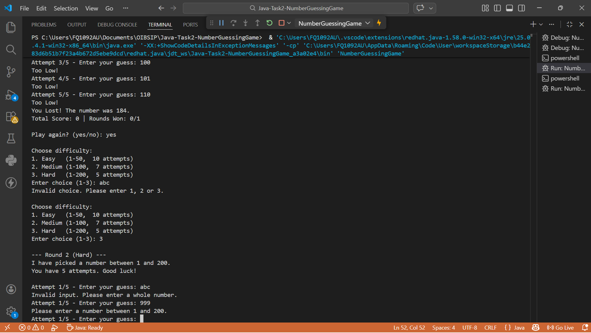

# Number Guessing Game (Java)

Console-based number guessing game built for the Oasis Infobyte Internship Program (Java Development, Task 2).

## Features
- Random number generation using `java.util.Random`
- Hints: "Too High!", "Too Low!", "Correct!"
- Attempt counter and maximum attempts limit
- "You Lost!" message that reveals the number
- Play Again option
- Score tracking across multiple rounds
- Bonus: 3 difficulty levels (Easy / Medium / Hard)
- Input validation (non-numeric and out-of-range input)

## Screenshots
| Win | Lose | Invalid Input |
|-----|------|---------------|
|  |  |  |

## How to Run
```bash
cd src
javac NumberGuessingGame.java
java NumberGuessingGame
```

## Concepts Used
`Random`, `Scanner`, loops, conditionals, methods, exception handling

## Author
Dinesh Balaso Kolekar - Java Development Intern, Oasis Infobyte