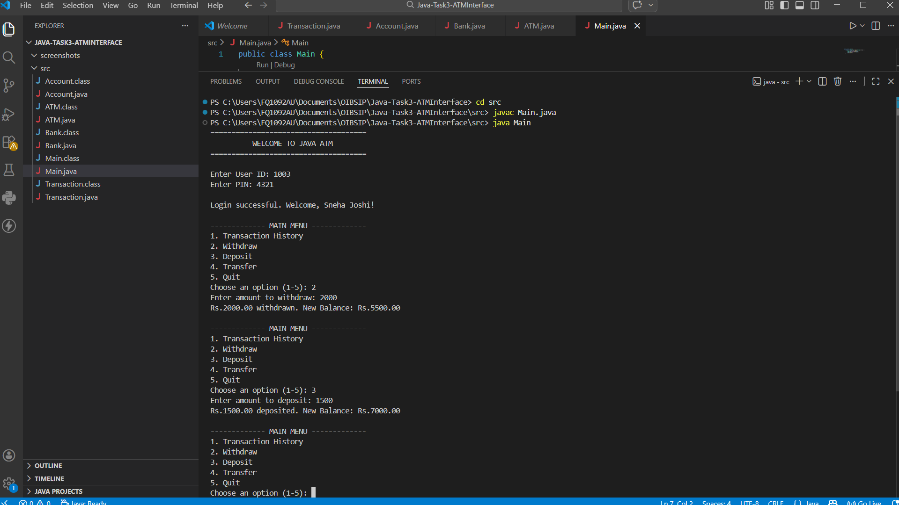
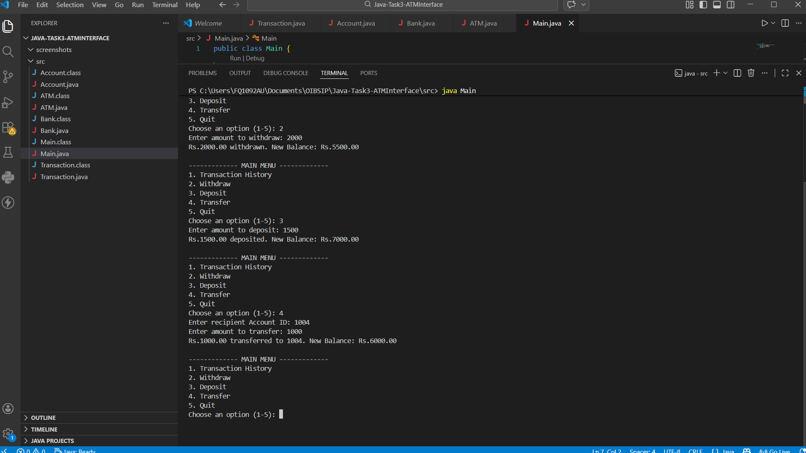
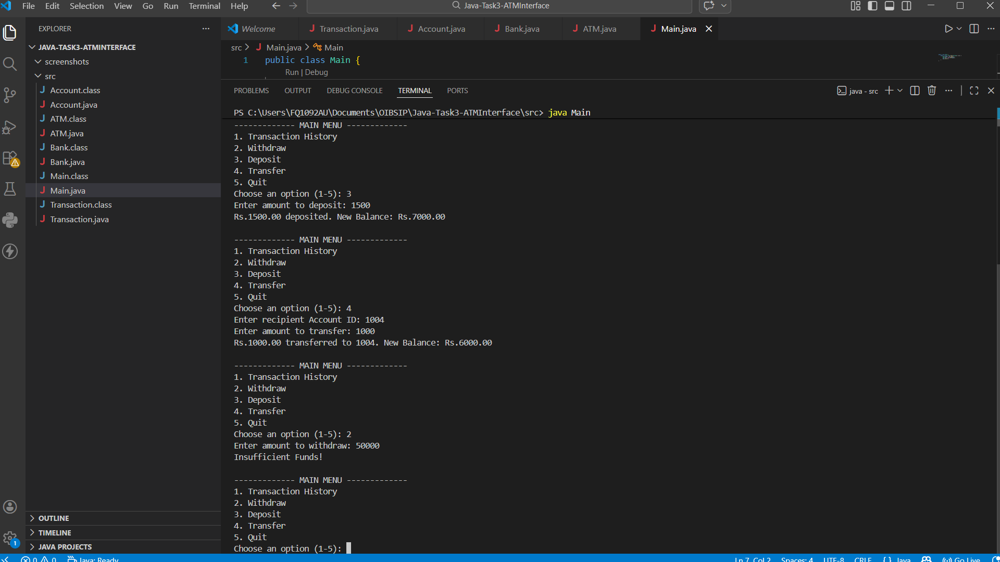
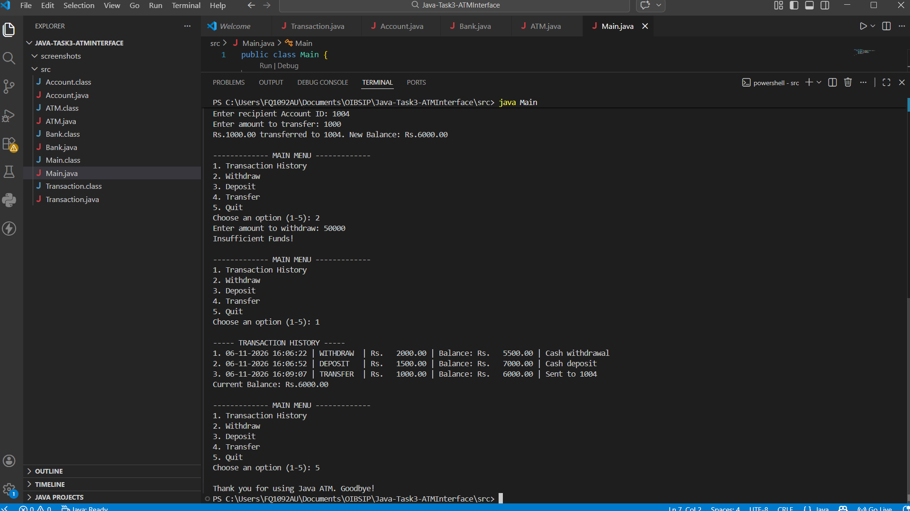

# ATM Interface (Java)

Console-based ATM simulation built for the Oasis Infobyte Internship Program (Java Development, Task 3).

## Features
- Login with User ID and PIN (access denied after 3 incorrect attempts)
- Transaction History (stored in `ArrayList`)
- Withdraw with balance check ("Insufficient Funds")
- Deposit
- Transfer between accounts (both accounts updated and logged)
- Quit option
- Input validation for amounts and menu choices

## Project Structure
| Class | Responsibility |
|-------|----------------|
| `Main` | Entry point |
| `ATM` | Menu, user interaction, login flow |
| `Bank` | Holds accounts, authentication, transfers |
| `Account` | Balance, PIN check, deposit/withdraw, history |
| `Transaction` | One transaction record |

## Demo Accounts
| User ID | PIN | Name |
|---------|-----|------|
| 1001 | 1234 | Dinesh Kolekar |
| 1002 | 5678 | Rahul Patil |
| 1003 | 4321 | Sneha Joshi |
| 1004 | 8765 | Amit Deshmukh |

## Screenshots (Demo with User 3 - Sneha Joshi)

| Login + Withdraw + Deposit | Transfer to User 4 |
|---|---|
|  |  |

| Insufficient Funds | Transaction History |
|---|---|
|  |  |

## How to Run
```bash
cd src
javac *.java
java Main
```

## Concepts Used
OOP (encapsulation, classes/objects), `ArrayList`, `HashMap`, `Scanner`, `switch-case`, exception handling

## Author
Dinesh Balaso Kolekar - Java Development Intern, Oasis Infobyte